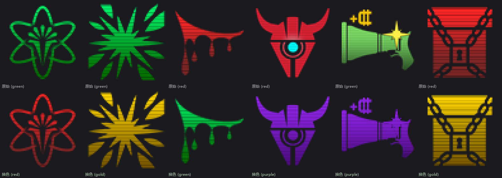

# UNGP 图标着色工具

`graphics/ungp/icons/ungp_rules` 下的规则图标都是同一套图层样式：白色图形先乘一层自上而下
由亮到暗的着色渐变（正片叠底），再叠一层 8 像素周期的电视扫描线。本脚本复刻这两层效果，用来给
新画的白色图标生成与现役图标同风格的正面（绿）、负面（红）、里程碑（紫）、黄金（金）版本。



只依赖 Pillow：

```powershell
python -m pip install pillow
```

## 双击运行（交互模式）

不想记命令行参数时，直接双击 `tools/icon_tint/图标着色.bat`（也可以双击 `icon_tint.py`，前提是 Windows
已把 `.py` 关联到 Python）：会打开一个控制台窗口，把图标文件或整个文件夹**拖进窗口**再回车（或者粘贴路径），
然后按数字选颜色，脚本就会在**输入文件所在目录**生成 `名字_green.png` 这样的副本，原始文件不会被改动。

用命令行进入同一个向导：

```powershell
python tools/icon_tint/icon_tint.py --interactive
```

交互模式的约定：

- 可以一次拖入多个文件或文件夹，每张图都写回它自己所在的目录。
- 目录只处理当前一层；当前层没有图片时自动改为包含子文件夹。
- 输入已经是彩色图标时，自动反解成白色底稿再重新上色；本来就是白色/灰度底稿则直接上色，不会重复压暗。
  判断不出原色系的图标（例如偏黄、偏青或整体半透明的图）会按色相归到最接近的红色或绿色反解，
  不会中途跳过；想精确指定就用命令行的 `--flatten --from`。
- 输出名 = `原文件名 + _色系`：`名字_green.png` 换成红色会得到 `名字_red.png`（先剥掉旧色系后缀），
  已经是目标色系的文件会跳过，同一次运行里目标重名的只写第一张。
- 同名副本直接覆盖（它只是上次生成的结果）。需要指定输出目录、后缀、亮度、扫描线强度时，用下面的命令行。

## 快速开始

```powershell
# 单张图标 -> ./tinted_green/my_icon.png
python tools/icon_tint/icon_tint.py art/my_icon.png --color green

# 整个目录（含子目录）批量着色，并生成"原始 / 着色"对照图
python tools/icon_tint/icon_tint.py art --color red --recursive --out-dir out/red --preview out/red_sheet.png

# 先看看会写哪些文件，不落盘
python tools/icon_tint/icon_tint.py art --color purple --dry-run

# 不想要扫描线，只要渐变
python tools/icon_tint/icon_tint.py art/my_icon.png --color gold --stripe 0

# 已经是绿色的成品，换成红色（先反解成白色底稿，再重新着色）
python tools/icon_tint/icon_tint.py art/existing_green.png --color red --flatten
```

输出统一为 PNG（RGBA），尺寸与输入一致。

## 参数

| 参数 | 默认值 | 说明 |
| --- | --- | --- |
| `inputs` | 无 | 图标文件或目录，可给多个 |
| `--color` | `green` | 色系：`green` / `red` / `purple` / `gold` |
| `--out-dir` | `./tinted_<色系>` | 输出目录，不存在会自动创建 |
| `--suffix` | 空 | 输出文件名后缀，例如 `--suffix _new` |
| `--recursive` | 关 | 递归处理目录 |
| `--preview` | 无 | 对照图输出路径，上排原始、下排着色 |
| `--flatten` | 关 | 输入是已着色的图标，先反解成白色底稿再上色（换色系用） |
| `--from` | 自动 | 配合 `--flatten` 指定输入原色系：`green` / `red` |
| `--gain` | `1.0` | 整体亮度增益，`1.2` 更亮、`0.8` 更暗 |
| `--mode` | `luma` | 白度取样：`luma` 按 Rec.709 亮度，`max` 取 RGB 最大值 |
| `--stripe` | `1.0` | 扫描线强度倍数，`0` 关闭，`0.5` 减半 |
| `--stripe-period` | `8` | 扫描线周期基准像素，按图标高度等比缩放 |
| `--stripe-phase` | `0` | 扫描线相位偏移，0–7 |
| `--overwrite` | 关 | 覆盖已存在的输出文件（默认跳过） |
| `--dry-run` | 关 | 只打印将要写入的路径 |
| `--interactive` | 关 | 进入交互式向导（无参数双击运行时自动进入） |
| `--calibrate` | 无 | 从现役图标重新标定并打印数据 |

## 输入要求

- **白色或灰度图形**：脚本按亮度当作"底稿覆盖率"乘上颜色，彩色图标会被压成单色并提示告警。
- **尺寸任意**：渐变按高度重采样成 16 段，扫描线周期按 `max(2, round(8 * 高度 / 64))` 缩放，
  因此 48×48 的图标也能用；但要和现役图标并排显示，还是按 `64×64` 出图。
- **alpha 直通**：脚本只改 RGB，alpha 原样保留；图像应当是直通（非预乘）alpha，与现役图标一致。
- 支持 `.png .jpg .jpeg .webp .bmp .tga`，输出一律为 PNG。

## 换色系：--flatten

现役图标大多是"白色底稿 × 渐变 × 扫描线"的成品。如果手里只有绿色成品、想要红色版，直接上色会
把颜色再乘一遍、整体发暗。加 `--flatten` 后脚本先用同一套模型把输入反解回白色底稿（自动判断原色系
和扫描线相位；判断不出原色系的图标会被跳过并提示，可用 `--from` 指定），再按目标色系重新着色：

```powershell
python tools/icon_tint/icon_tint.py art/green_icon.png --color red --flatten

# 批处理时判断不出原色系的图标会被跳过并提示，不会中断整批
python tools/icon_tint/icon_tint.py art --color red --flatten --recursive
```

把现役 76 张图标逐张"反解再按原色系重新着色"，与原始文件对比（统计口径：只算 alpha ≥ 32 的像素，
三个通道的差值合在一起取中位数）：能判断出原色系的 73 张里有 36 张误差小于 `4/255`，按形状描线的
图标几乎是精确复刻（例如 `son_of_core` 最大误差 `10/255`）。误差偏大的分三类——画师额外画了彩色点缀的
（`collector`、`elite_reserves`、`more_logistics`）、自己改了亮度曲线的（`close_formation`、`industrial_zone`）、
以及整体半透明的（`wide_radar`）。前两类在换色时会被**归一化到标准渐变**，即换色后的图标在亮度上比原图
更统一，这是有意的；如果希望保留原图的亮度曲线，就不要用 `--flatten`，而是直接给工具一张自己画的白色底稿。

## 色系来源

| 色系 | 来源 |
| --- | --- |
| `green` | 从现役绿色图标实测标定（16 段查表，`--calibrate` 会打印参与张数） |
| `red` | 从现役红色图标实测标定（16 段查表，同上） |
| `purple` | 顶端比 `MILESTONE_COLOR(158,41,255)` 更亮，末端更暗，以保持清晰渐变 |
| `gold` | 由 `GOLDEN_COLOR(255,215,0)` 按实测衰减曲线推导出端点色 |

调色板定义见 `src/ungp/scripts/campaign/specialist/rules/UNGP_RulesManager.java:40-43`
（`POSITIVE_COLOR(50,255,50)`、`NEGATIVE_COLOR(255,50,50)`、`GOLDEN_COLOR(255,215,0)`、
`MILESTONE_COLOR(158,41,255)`）。绿色和红色直接用了实测结果而不是调色板原值，因为实际渲染出的
渐变与调色板并不相同（红族绿/蓝通道恒为 `0.14`，绿族蓝通道从 `0.42` 降到 `0`）。

## 渐变与扫描线的推导方式

现役图标满足：

```
输出 RGB = 底稿亮度 × 渐变(y) × 扫描线(y mod 8)，alpha 原样保留
```

- **渐变**：渐变只随 y 变化，同一行内只有扫描线带来的噪声。对每张图标逐行取 `alpha == 255` 像素的
  92 分位（避开图内暗部），再跨图标取中位数，即可还原"白色底稿=255"处的真实着色值；最后压成 16 段。
- **扫描线**：周期 8 像素，每张图标的相位是随机的。把每张图的行亮度除以渐变后，按最暗位置对齐、
  取中位数并归一化，得到 `STRIPE_PROFILE`；实测振幅约 ±6%～7%。
- **精度**：模型在按形状描线的图标上几乎是精确复刻（例如 `son_of_core` 往返误差为 `0`），
  误差主要来自画师额外加的彩色点缀和自定义亮度曲线，具体见上文「换色系」一节。

美术侧调整了渐变或扫描线之后，用下面的命令重新标定，把打印出的 `GREEN_STOPS` / `RED_STOPS` /
`STRIPE_PROFILE` 粘回脚本顶部即可（输出末尾会给出两个色系合并后的 `STRIPE_PROFILE`，一般直接用那一条）。
标定口径与内置值来自同一套算法，但样本和取整会有约 1% 的出入，属正常：

```powershell
python tools/icon_tint/icon_tint.py --calibrate
```

## 备注

- 输出统一为 UTF-8。双击运行的窗口里中文显示正常；如果把输出重定向到文件或用老式管道，
  可能需要先 `chcp 65001`（Windows Terminal 和 PowerShell 7 默认就是 UTF-8，一般不需要）。
- 递归处理不同子目录下的同名图标时，后来的文件会自动改名为 `名字_2.png` 并打印提示，不会互相覆盖。
- `--out-dir` 位于输入目录内部时，输出目录会被自动排除，不会把刚生成的结果再处理一遍。
- `--dry-run` 不会创建目录、不会写图片，也不会生成对照图。
